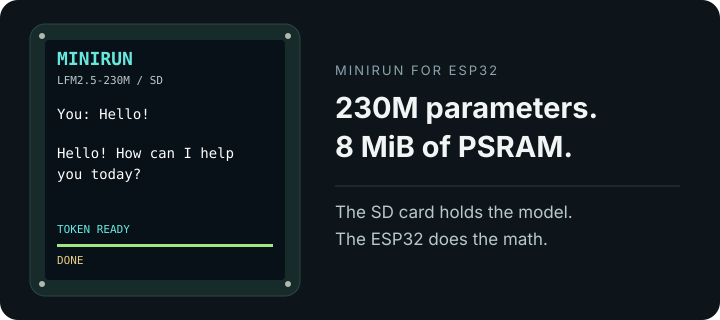

# Minirun for ESP32

A 230M language model, an SD card, and an ESP32-S3.

[Get started](docs/getting-started.md) · [Hardware](docs/hardware.md) · [How it works](docs/how-it-works.md) · [中文](README.zh-CN.md)

Minirun runs **LFM2.5-230M on the ESP32-S3 itself**. The model lives on an SD card. The board reads small pieces of it as it goes, using both CPU cores to overlap reading and computation.

Connect it to a Mac, type a message, and watch the reply appear on its 240 × 240 screen. The display shows each layer and the progress of the current token. The Mac handles text input and drawing letters; the board does the neural network calculations.

<p align="center"></p>

*Display illustration using a reply generated by the board.*

```text
You: Hello!

Minirun: Hello! How can I help you today?
```

It takes about **37 seconds per new token** on the tested board. This is a small electronics project for people who want to see a language model working up close. A short reply is a good place to start.

## Make it talk

You need an **ESP32-S3 EYE with 8 MiB PSRAM and 8 MiB flash**, a FAT32 microSD card, a USB data cable, and a Mac. The tested board is the YD-ESP32-S3-EYE-MB v2.2. Other S3 boards need matching SD and display wiring.

Start with the [setup guide](docs/getting-started.md) to build the firmware and put the model on the card. Once that is done:

```sh
source .venv/bin/activate
python tools/chat.py --prompt 'Hello!' --new-tokens 16
```

One connected ESP32-S3 is detected automatically. Omit `--prompt` to enter your message in the terminal. The reply appears as it is generated, on both the terminal and the LCD.

A few things to try:

```sh
python tools/chat.py --prompt 'Name a tiny robot that lives in a teacup.'
python tools/chat.py --prompt 'Write one sentence about a lighthouse on the moon.'
python tools/chat.py --prompt 'What is 2 + 2?'
```

Each command starts a new conversation. `--new-tokens` limits the reply length. Press **Ctrl+C** to stop.

## What fits on the board

| | Current default |
|---|---|
| Model | LFM2.5-230M, official QAD Q4_0 GGUF |
| Model file on SD | 149 MB |
| Context | Up to 1024 tokens, shared by the message and reply |
| Conversation cache | FP32, stored in pages on SD |
| Screen | ST7789, 240 × 240 |
| Connection | USB serial |

The model includes Q6_K and FP32 tensors alongside Q4_0. Preparing the SD file rearranges its storage layout and preserves the weight values.

A short message uses only the context it needs. The maximum conversation cache is 24 MiB on SD, with about 704 KiB of RAM used to work on it. The program stops when the context is full. Conversation history is not retained between runs.

## Take it apart

- **[Setup](docs/getting-started.md):** software, firmware, SD card, first reply.
- **[Hardware](docs/hardware.md):** pins, display settings, other boards.
- **[Inside Minirun](docs/how-it-works.md):** how a 149 MB model runs with 8 MiB PSRAM, and why it takes its time.
- **[Development](docs/development.md):** code map, tests, serial commands, and things to experiment with.

The C runtime is small enough to read. Start with [`src/lfm.c`](src/lfm.c) for the model, [`firmware/main/pipeline.c`](firmware/main/pipeline.c) for the two CPU cores, or [`src/kv_file.c`](src/kv_file.c) for the SD conversation cache.

## License and credits

Minirun's code and documentation are [MIT licensed](LICENSE). Model weights use Liquid AI's separate [LFM Open License](third_party/LFM-Open-License-v1.0.txt) and are downloaded from [LiquidAI/LFM2.5-230M-GGUF](https://huggingface.co/LiquidAI/LFM2.5-230M-GGUF).

Built with ESP-IDF. Text tokenization uses llama.cpp. Quantized tensor decoding follows ggml, and the board's ASCII font comes from font8x8. See [third-party credits](third_party/README.md).
